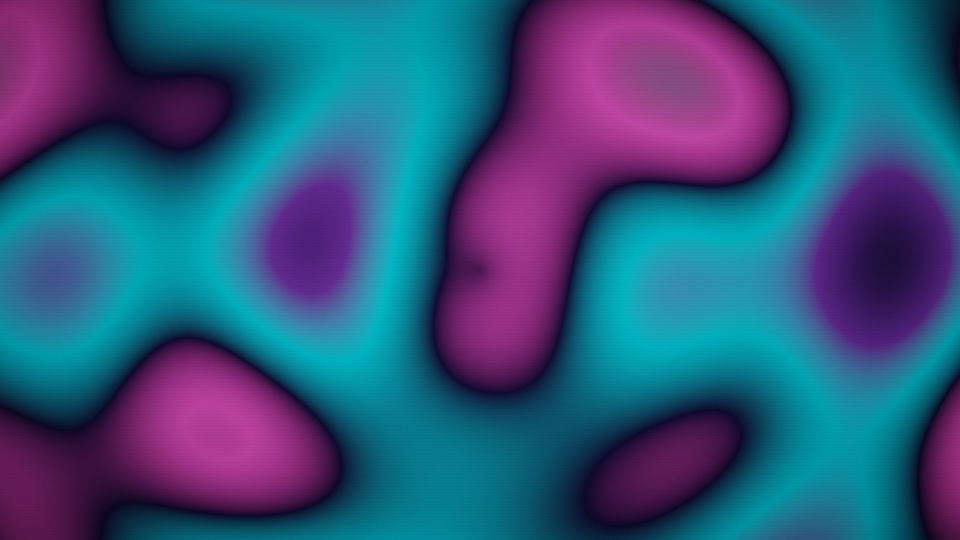
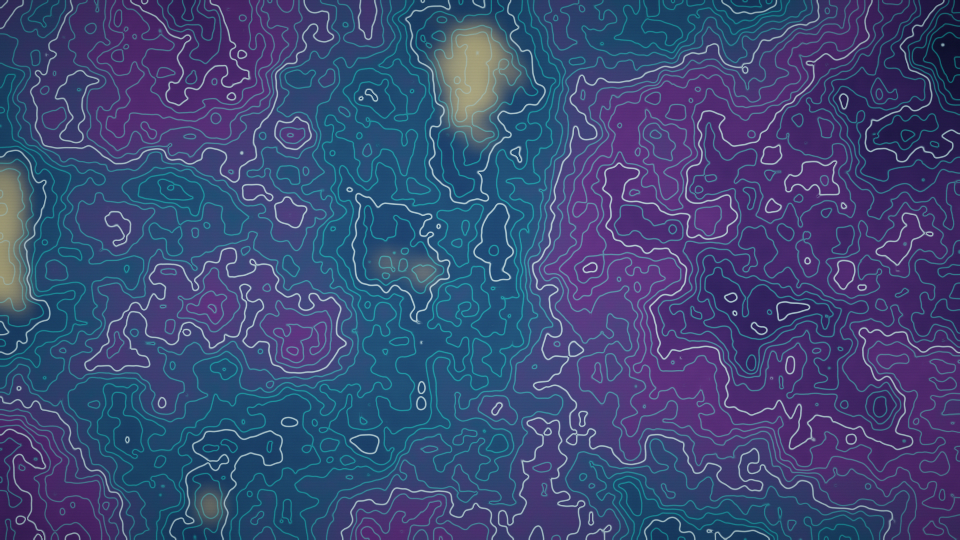
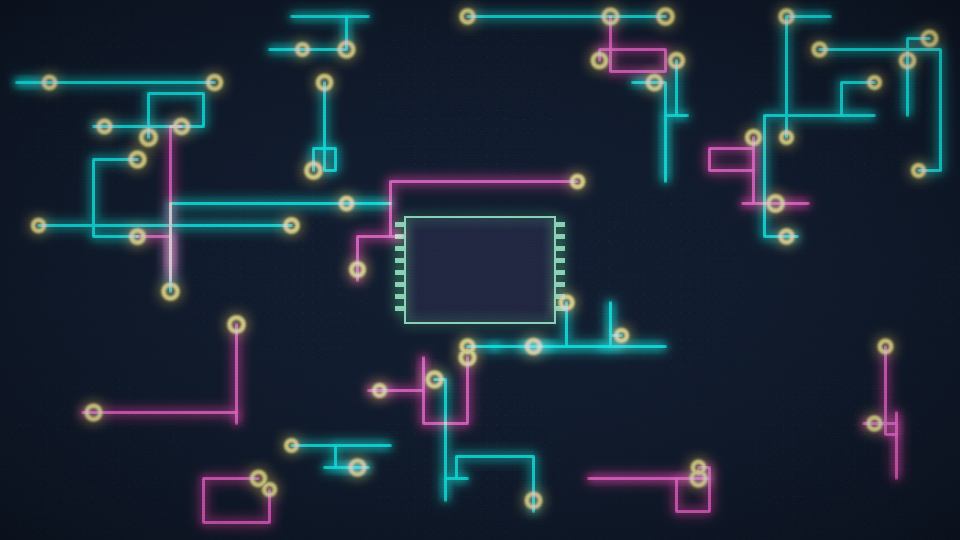
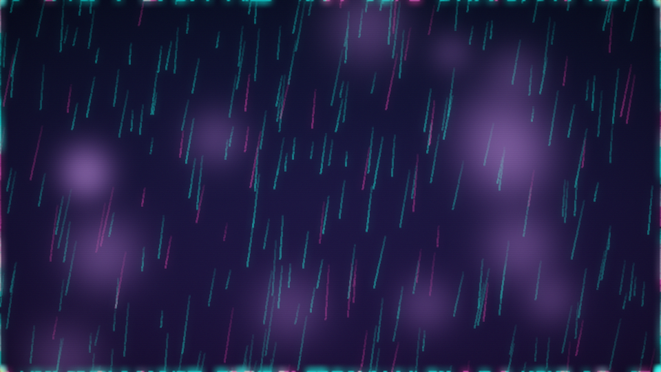
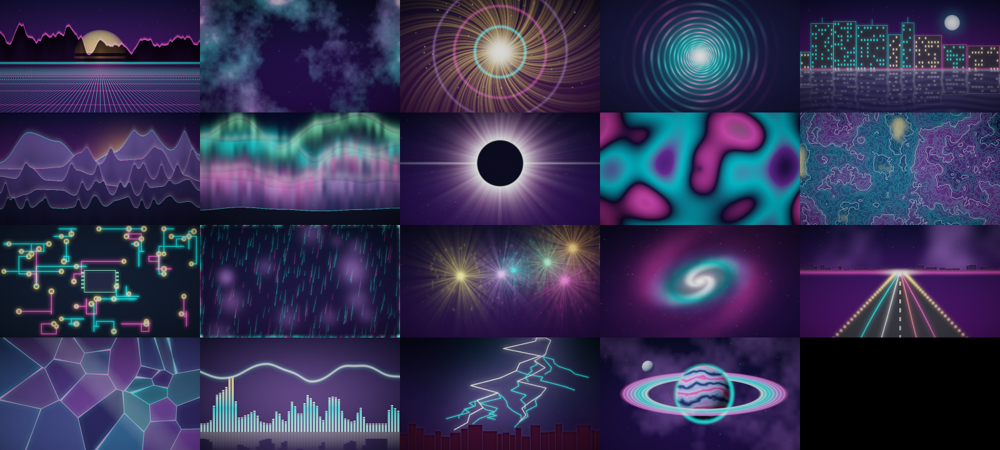

# NEON VANGUARD

Ein Neon-Arcade-Shooter im Stil der 80er – komplett aus dem Programm code
erzeugt: **kein einziges Bild, kein einziger Sound, keine Musikdatei**.

## Start

```bash
python main.py
```

Benötigt: `pygame-ce` (oder `pygame`) und `numpy`.

## Steuerung

| Taste | Funktion |
|---|---|
| WASD / Pfeiltasten | Bewegen |
| Maus | Zielen |
| Linke Maustaste / Leertaste | Feuern (halten für Dauerfeuer) |
| P / ESC | Pause |
| M | Ton an/aus |
| R | Neustart |
| Enter / Klick | Starten (im Menü bzw. nach Game Over) |

## Die 5 Imports (und warum genau diese)

| Import | Aufgabe |
|---|---|
| `pygame` | Fenster, Rendering, Eingabe, Mixer |
| `numpy` | Synthese aller Sounds + Musik, Bloom-Postprozess, Hintergrund |
| `math` | Winkel, Vektoren, Bewegungsmuster |
| `random` | Wellen-Zusammensetzung, Spawnorte, Partikel |
| `sys` | sauberes Beenden (`sys.exit`) |

Alles andere sind eigene Module (`settings`, `audio`, `gfx`, `entities`,
`game`) – Dateien statt Imports.

## Aufbau

```
main.py      Einstieg
game.py      States (Menü/Play/Pause/Over), Waves, Kollisionen, HUD
entities.py  Spieler, Kugeln, 5 Gegnertypen, Boss, Powerups
gfx.py       Glow-Sprites, Bloom, Sternenhimmel, Partikel, Floating Text
audio.py     prozedurale Sound-Engine + prozedurale Loop-Musik (numpy)
settings.py  Konstanten und Farbpalette
neon_art.py  prozeduraler Art-/Wallpaper-Generator (PNG, ohne Display)
```

## Technik

- **Sound:** Jeder Sound wird zur Laufzeit aus Sinus/Noise/Envelope-Berechnungen
  gebaut (`numpy` → `pygame.sndarray`). Die Musik ist eine 8-taktige Schleife
  (Kick/Snare/Hats/Bass/Arp/Pad, Am–F–C–G, 126 BPM), ebenfalls synthetisiert
  und läuft endlos auf einem eigenen Kanal.
- **Bloom:** Die Szene wird auf 1/4 verkleinert, Helliges isoliert
  (Schwelle 118) und additiv zurückgeblendet → satter Neon-Look für ~2 ms.
- **Juice:** Screen-Shake (Trauma), Hit-Stop, Schadensblitz, Partikel,
  Score-Popups, Combo-Multiplikator (bis x4), Magnet-Powerups.
- **Gegner:** Chaser, Dart, Shooter, Orb, Tank – plus Boss „Void Sentinel"
  mit 3 Phasen (gezielter Salvo → Ring-Burst → Spirale).
- **Performance:** ~6 ms pro Frame bei 1280×720 (Update + Render + Bloom),
  deutlich über 60 fps.

## Art-Generator

`neon_art.py` erzeugt Wallpaper und Key-Art im Look des Spiels – wie die
Sounds und die Spielgrafik selbst komplett aus Zahlen berechnet, ohne eine
einzige Bilddatei als Vorlage. Läuft ohne Display (nur `numpy`) und schreibt
PNGs. **19 Motive**, alle per Seed reproduzierbar.

```bash
python neon_art.py --list
python neon_art.py grid --size 1920x1080 --seed 7 --out art/grid.png
python neon_art.py all --size 1280x720 --out art
```

Vier Motive, jedes mit eigenem Seed reproduzierbar:

| `grid` – Synthwave-Horizont | `nebula` – Sternennebel |
|---|---|
|  |  |

| `burst` – Explosion | `tunnel` – Vortex |
|---|---|
|  |  |

### Die 15 weiteren Motive

| `city` – Skyline mit Wasser-Spiegelung | `ridges` – Bergketten mit Nebel |
|---|---|
|  |  |

| `aurora` – Polarlicht | `eclipse` – Sonnenfinsternis |
|---|---|
|  |  |

| `plasma` – Interferenz-Muster | `topo` – Höhenlinien-Topografie |
|---|---|
|  |  |

| `circuit` – Leiterplatte | `rain` – Neon-Regen |
|---|---|
|  |  |

| `fireworks` – Feuerwerk | `galaxy` – Spiralgalaxie |
|---|---|
|  |  |

| `highway` – Autobahn-Lichtspuren | `shards` – Glas-Facetten |
|---|---|
|  |  |

| `eq` – Audio-Visualizer | `lightning` – Gewitterblitze |
|---|---|
|  |  |

| `orbit` – Planet mit Ringen |
|---|
|  |

Alle 19 Motive auf einen Blick (jeweils Seed 42, 640×360):



## Dateien

Der Highscore wird in `neon_vanguard_highscore.txt` gespeichert.
